<a id="top"></a>
<div align="center">

<picture>
  <source media="(prefers-color-scheme: light)" srcset="docs/media/readme/banner-en-light.svg"/>
  
</picture>

[](https://python.org)
[](https://fastapi.tiangolo.com)
[](https://electronjs.org)
[](https://react.dev)
[](https://typescriptlang.org)
[](./unity-mcp)
[](LICENSE)

**English** · [Türkçe](./README_TR.md)

</div>

<br/>

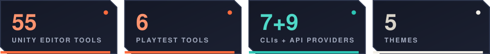

<br/>

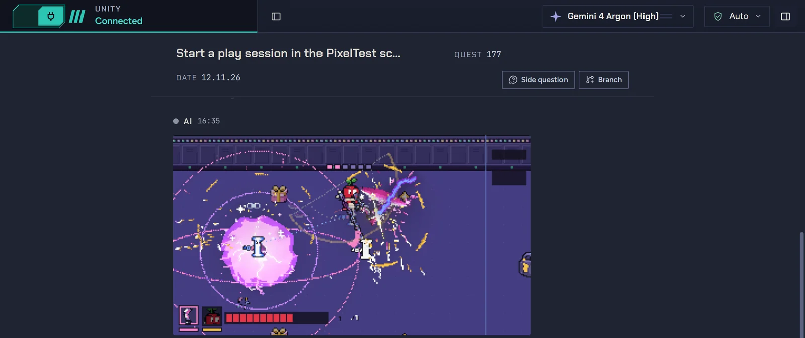

<p align="center"><sub>A real session: the agent started a play session in the Unity Editor and posted what the game camera saw mid-fight.</sub></p>

Gamachine is a desktop app for Windows and macOS that puts AI coding agents (Claude Code,
Codex, Antigravity, Copilot, your own API keys) in one chat, wired to your open Unity Editor.
In v4 the agent does more than write code: it **plays the game in the real Editor**, looks at
what it built, and several chats work on the same project side by side.

<div align="center">

<br/>

<a href="https://github.com/BurakErdemci/gamachine/releases/latest"></a>

| Platform | File |
|---|---|
| **Windows 10/11** (x64) | `Gamachine-Setup-<version>.exe` |
| **macOS** (Apple Silicon) | `Gamachine-<version>-arm64.dmg` |

<sub>**Windows:** the installer is not code-signed, so SmartScreen warns on first run:
*More info* → *Run anyway*. No Intel Macs, no Linux.
Building from source? See [Installation](#installation).</sub>
<!-- MAC-SIGNING-TBD: add one line here once the macOS signing state of the release is settled (signed and notarized, or right-click → Open). -->

</div>

<br/>

<a id="playtest"></a>

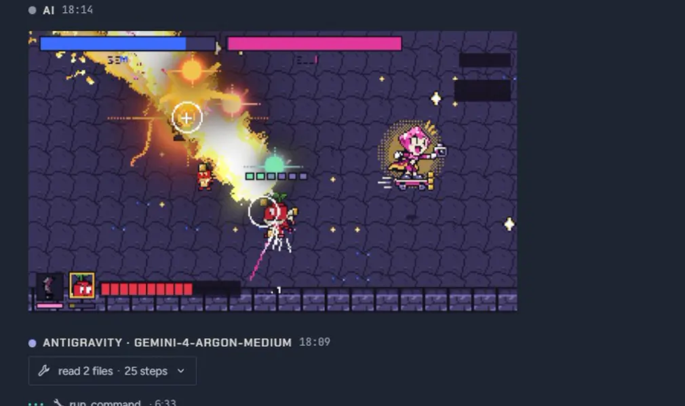

Six playtest tools let an agent enter Play Mode in the **real Unity Editor**, step the game
frame by frame while pressing keys and buttons, and get the frame back as an image. Here it
takes a playtester's report on a game in development, changes two lines, confirms a clean
compile, replays the same sequence and commits.

<sub>Also: background runs of up to 30 game-minutes across up to 50 seeds, hooks the game
declares with `[GameHook]`, and `*.playtest.json` scenarios with pass/fail.
Needs Unity's Input System package. A bot playing shows the game runs, not that it is fun.</sub>

<br/>

<a id="live-unity"></a>

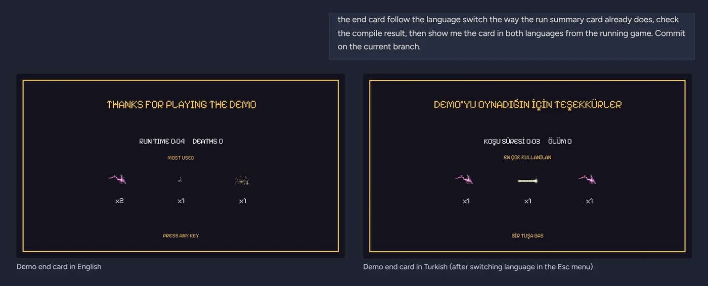

**55 Unity Editor tools** over MCP: scenes, GameObjects, prefabs, materials, scripts, the
console. Asked to make an end card follow the language switch, the agent checked the compile
result and showed the card in both languages, captured from the running game.

<sub>"Compiled clean" now means it compiled: a `compile_status` verdict, not an empty console.
Every agent action is one named Undo step, and raw `.meta` or scene-YAML writes are refused
in every mode, so asset GUIDs stay intact.</sub>

<br/>

<a id="parallel-chats"></a>

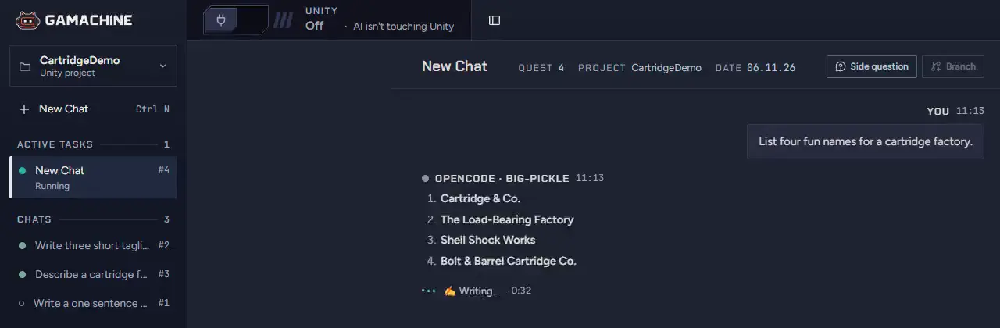

Chats run in parallel, each with its own stream, Stop button and queue; writes to one Editor
are taken in turn. Branch a chat into a tab, ask a read-only side question, or let one chat
leave a note that wakes another:

<p align="center">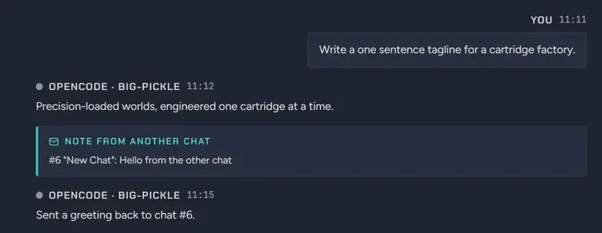</p>

<br/>

<a id="blender"></a>

<table>
<tr>
<td width="58%">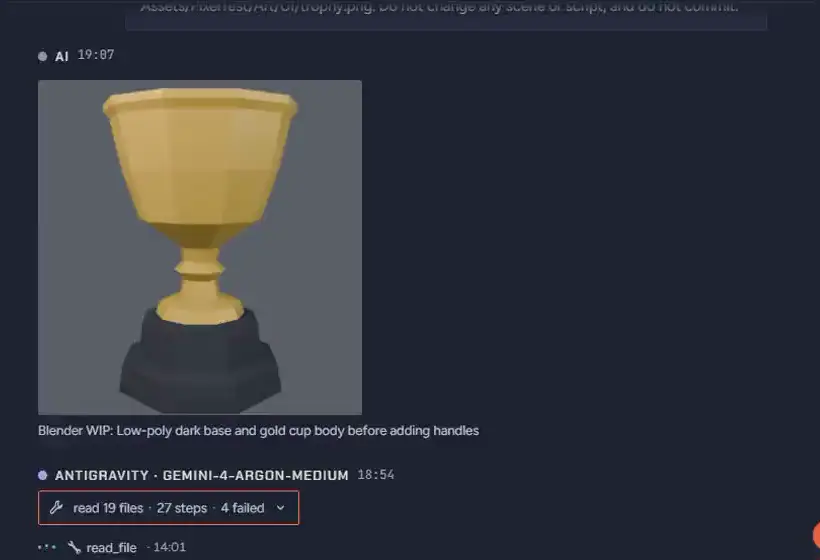</td>
<td width="42%">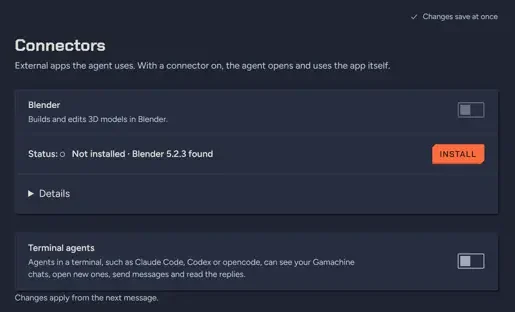</td>
</tr>
<tr>
<td>Blender work done by the agent: a low-poly trophy for the game's end card, shown in the chat as it took shape, then rendered to a transparent PNG.</td>
<td><b>Settings › Connectors</b> installs the Blender add-on (Blender 4.2+): the agent then reads the scene, runs Python in it and looks at the result.</td>
</tr>
</table>

<br/>

<a id="projects"></a>


<p align="center">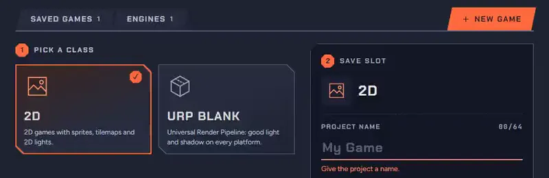</p>

Open a project, launch Unity, or create one with the editor and template you pick. You can
also install a Unity version and its modules from here; it uses Unity Hub 3.21+ and never
logs in to Unity for you.

<br/>

<a id="providers"></a>

<table>
<tr>
<td width="50%">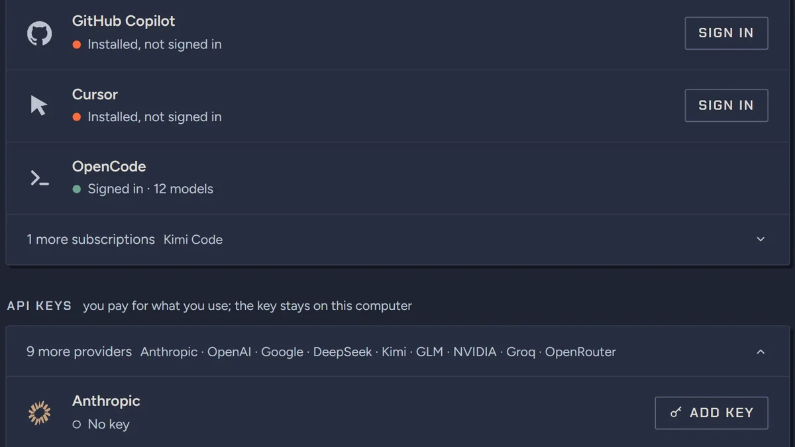</td>
<td width="50%">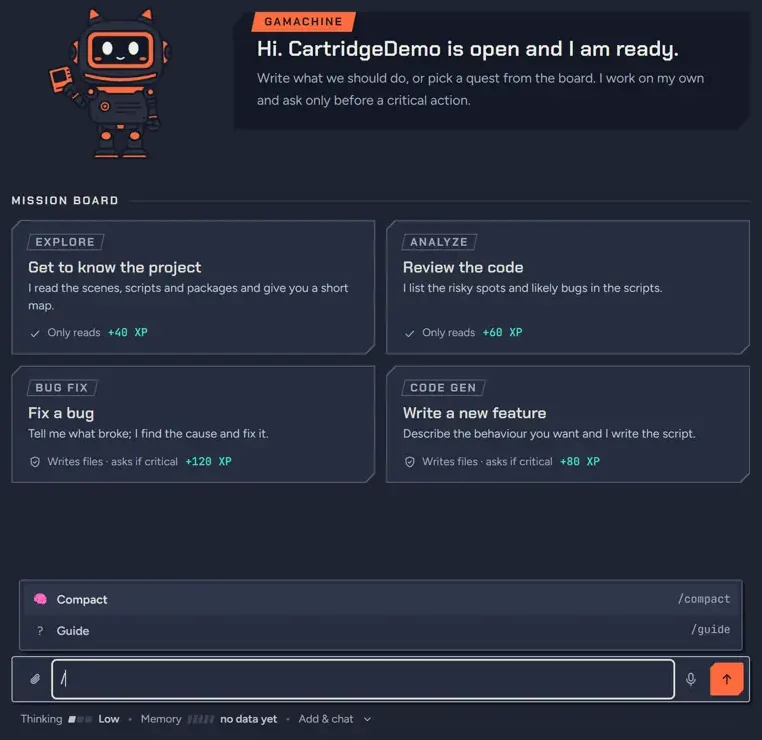</td>
</tr>
<tr>
<td><b>7 subscription CLIs</b> run with your own login (Claude Code, Codex, Antigravity, Copilot, Cursor, OpenCode, Kimi Code), plus <b>9 API providers</b> and local Ollama. Keys stay on your computer.</td>
<td>One work mode for every agent: <b>Safe Auto</b> (the default) lets routine work through and asks before critical, irreversible actions; <b>Step by Step</b> and <b>Auto</b> sit either side.</td>
</tr>
</table>

<sub>Works best with Claude Code, which is what we build and test Gamachine with. Kimi Code
has not been exercised end to end, and Ollama has only partial Unity control.</sub>

<br/>

<a id="themes"></a>

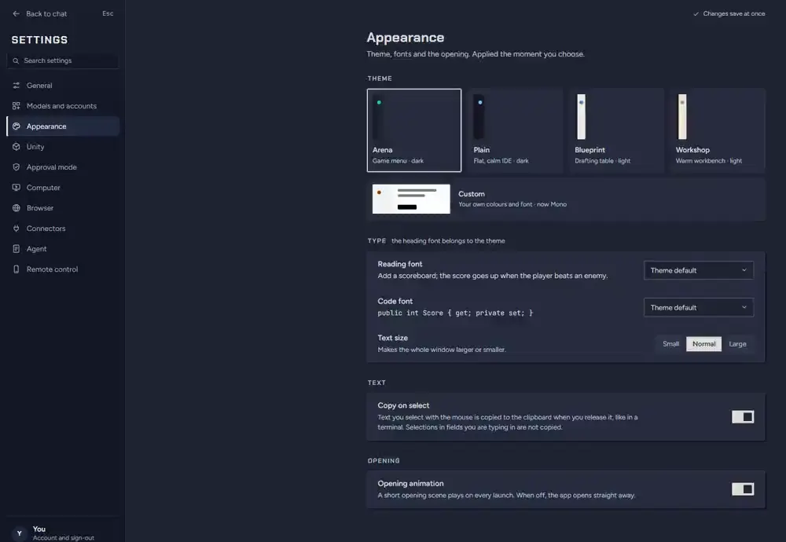

Five themes (Arena, Plain, Blueprint, Workshop, and Custom with your own colours and fonts),
an English or Turkish interface, a Guide screen and a six-step starter tour.

<br/>

<a id="also-in-v4"></a>

<table>
<tr>
<td width="50%" valign="top"><b>Computer use</b><br/>Off by default. The agent takes screenshots, clicks and types in desktop apps you allow one by one; a live view shows it, Ctrl+Alt+Esc (Cmd+Shift+Esc) stops it. Tested most with Claude Code and Codex; not with Ollama.</td>
<td width="50%" valign="top"><b>Agent browser</b><br/>Off by default. A built-in browser the agent can search, read, click and fill forms in; submitting, passwords and purchases need your approval. Annotate a page (Ctrl+Shift+E) and send the notes. <a href="docs/agent-browser.md">More</a></td>
</tr>
<tr>
<td width="50%" valign="top"><b>Phone and web remote</b><br/>Off by default. Pair a phone with a QR code and a 4-digit check, then watch chats, approve cards, send messages and stop turns. End-to-end encrypted; the PC stays on. <a href="docs/remote-control.md">More</a></td>
<td width="50%" valign="top"><b>Terminal agents</b><br/>Claude Code, Codex and other CLI agents can list your chats, open one and message it through a local MCP server. <a href="docs/terminal-agents.md">More</a></td>
</tr>
<tr>
<td width="50%" valign="top"><b>Scene editor</b><br/>An optional Hierarchy and Inspector for the open scene, for you rather than the agent. No 3D view.</td>
<td width="50%" valign="top"><b>Dictation</b><br/>Whisper runs on your computer; nothing is sent until you press Enter, and no audio leaves the machine. The Windows installer is about 1.3 GB because the model ships inside it. <!-- MAC-DICTATION-TBD: state macOS availability here once settled. --></td>
</tr>
<tr>
<td width="50%" valign="top"><b>Models</b><br/>Claude Fable 5.2, Opus 5.5, Sonnet 5.5, Haiku 5.5; GPT-6 Luna and Sol, GPT-6.1 Sol and gpt-6.1-terra for Codex; Gemini 4 Argon through agy 1.4.0.</td>
<td width="50%" valign="top"><b>Images and @</b><br/>Agents can put an image in the chat with <code>show_image</code>; typing <code>@</code> lists your other chats so the agent can leave one a note.</td>
</tr>
</table>

Full list: [CHANGELOG.md](CHANGELOG.md). Known limits: [release notes](RELEASE_NOTES.md).

<br/>

<br/>

<a id="documentation"></a>


<table>
<tr><td><a href="docs/engineering-notes.md"><b>Engineering notes</b></a></td><td>The decisions, the mistakes, and what they cost</td></tr>
<tr><td><a href="docs/architecture.md"><b>Architecture</b></a></td><td>Process layout, agentic loop, tool layer, SSE stream</td></tr>
<tr><td><a href="docs/security.md"><b>Approval &amp; security</b></a></td><td>What is gated, what deliberately isn't, and why</td></tr>
<tr><td><a href="docs/unity-mcp.md"><b>Unity MCP integration</b></a></td><td>The Editor tools, the tool list per URL, playtesting and the input system</td></tr>
<tr><td><a href="docs/providers.md"><b>Supported providers</b></a></td><td>Every CLI agent, cloud API and local model</td></tr>
<tr><td><a href="docs/building.md"><b>Building from source</b></a></td><td>Dev setup and producing a dmg / installer</td></tr>
</table>

<br/>

<a id="installation"></a>

**Using the app:** download it from
[Releases](https://github.com/BurakErdemci/gamachine/releases/latest), then add an API key or
sign in to a CLI agent you already use. The chat stays locked until one is connected, and we
never install a third-party AI tool without telling you. Python, `uv`, OmniSharp, the .NET
SDK and ffmpeg/yt-dlp are bundled.

**From source:** you need Python 3.13+ and Node.js 20+ (plus the Unity Editor, 2021.3 or
newer, for the Unity integration). Full steps, environment variables and packaging are in
[Building from source](docs/building.md).

**The previous version (v3)** stays on the
[`legacy-v3`](https://github.com/BurakErdemci/gamachine/tree/legacy-v3) branch, as it was,
with no new features.

<br/>

<a id="contributing"></a>

Three test suites guard the code:

```bash
# Backend
cd Backend && pytest
#   Windows: venv\Scripts\python.exe -m pytest   (env: PYTHONUTF8=1)

# unity-mcp server
cd unity-mcp/Server && pytest

# Frontend + the TypeScript gate
cd Frontend/frontend && npm test && npx tsc --noEmit
```

CI (`.github/workflows/test.yml`) runs five jobs: backend tests, a black-box contract suite,
unity-mcp server tests, the frontend gate (tsc + vitest) and a PowerShell syntax check. The
release build waits for all of them.

1. Fork the repo
2. Create a feature branch (`git checkout -b feat/amazing-feature`)
3. Run the tests
4. Open a pull request

<br/>

<a id="developer"></a>


**Burak Emre Erdemci**

An open-source portfolio and research project for developers who want to change how Unity
games are made with AI.

<br/>

<a id="license"></a>


**[MIT](LICENSE)**: free, with no licence key and nothing to buy.

- ✅ **Use it** for personal, educational, research or commercial work
- ✅ **Study, modify, fork and redistribute it**
- ✅ **Sell the games you make with it**: what you create is yours

You pay your own AI provider. For third-party component licences, see
[THIRD-PARTY-NOTICES.md](THIRD-PARTY-NOTICES.md) (the bundled FFmpeg is LGPL-3.0 on Windows
and GPL-3.0 on macOS/Linux, and is only ever run as a separate process).

Reporting a vulnerability: [SECURITY.md](SECURITY.md) ·
Contributing: [CONTRIBUTING.md](CONTRIBUTING.md)

<br/>

<a id="trademarks"></a>


This project is **not affiliated with, sponsored by, or endorsed by** Unity
Technologies. "Unity" and "Unity Technologies" are trademarks or registered
trademarks of Unity Technologies or its affiliates in the U.S. and elsewhere.
Likewise "Unreal Engine" is a trademark of Epic Games, "Godot" of the Godot
Foundation, "Claude" of Anthropic, "Codex" and "GPT" of OpenAI, "Gemini" and
"Antigravity" of Google, "GitHub Copilot" of GitHub, "Cursor" of Anysphere, and
"Blender" of the Blender Foundation. These names are used only to **describe**
compatibility.

Gamachine is not endorsed or authorised by Unity; if you have accepted Unity's
[Terms of Service](https://unity.com/legal/terms-of-service), you remain bound by them,
including Section 17.2 on AI-agent access.

<br/>

<p align="center"><a href="#top"></a></p>
