<a id="top"></a>
<div align="center">

<picture>
  <source media="(prefers-color-scheme: light)" srcset="docs/media/readme/banner-tr-light.svg"/>
  
</picture>

[](https://python.org)
[](https://fastapi.tiangolo.com)
[](https://electronjs.org)
[](https://react.dev)
[](https://typescriptlang.org)
[](./unity-mcp)
[](LICENSE)

[English](./README.md) · **Türkçe**

</div>

<br/>

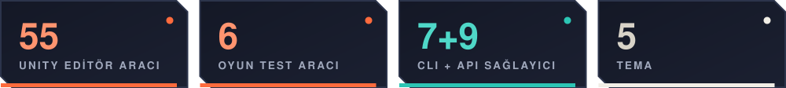

<br/>

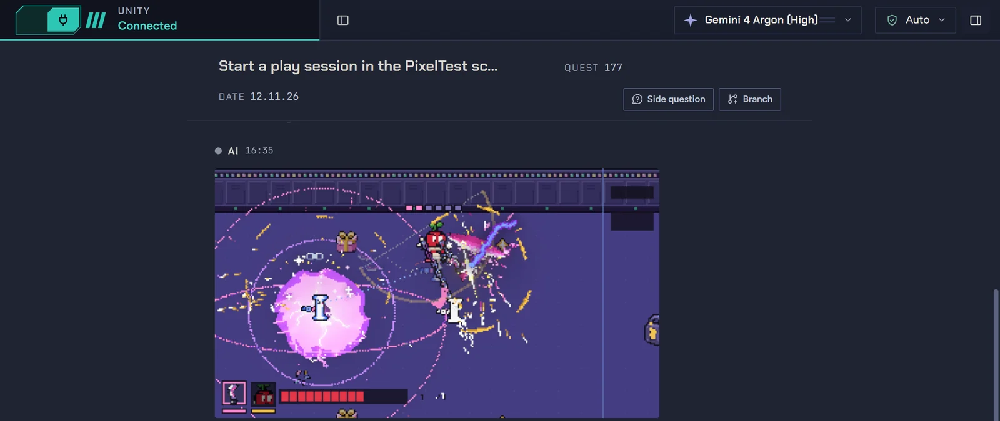

<p align="center"><sub>Gerçek bir oturum: ajan Unity Editor'de oyunu başlattı ve dövüşün ortasında oyun kamerasının gördüğünü sohbete koydu.</sub></p>

Gamachine, Windows ve macOS için bir masaüstü uygulaması: Claude Code, Codex, Antigravity,
Copilot gibi kodlama ajanlarını ya da kendi API anahtarlarını tek sohbette toplar ve açık
Unity Editor'üne bağlar. v4'te ajan kod yazmakla kalmıyor; **oyunu gerçek Editor'de oynuyor**,
yaptığına bakıyor, birkaç sohbet de aynı projede yan yana çalışıyor.

<div align="center">

<br/>

<a href="https://github.com/BurakErdemci/gamachine/releases/latest"></a>

| Platform | Dosya |
|---|---|
| **Windows 10/11** (x64) | `Gamachine-Setup-<sürüm>.exe` |
| **macOS** (Apple Silicon) | `Gamachine-<sürüm>-arm64.dmg` |

<sub>**Windows:** kurulum dosyası imzalı değil, ilk açılışta SmartScreen uyarır:
*Daha fazla bilgi* → *Yine de çalıştır*. **macOS:** Developer ID ile imzalı ve Apple onaylı,
uyarısız açılır. Intel Mac ve Linux yok.
Kaynaktan derlemek için: [Kurulum](#kurulum).</sub>

</div>

<br/>

<a id="oyun-testi"></a>

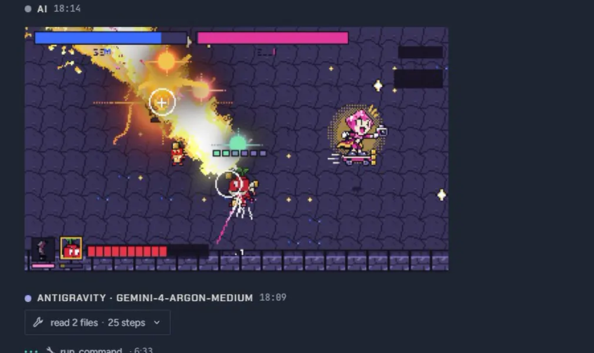

Altı test aracıyla ajan **gerçek Unity Editor'de** Play Mode'a giriyor, tuş ve düğmelere
basarak oyunu kare kare ilerletiyor, kareyi görüntü olarak geri alıyor. Burada geliştirilen
bir oyundaki test oyuncusu bildirimini alıyor: iki satırı değiştiriyor, derlemenin temiz
olduğunu görüyor, aynı diziyi yeniden oynuyor ve commit'liyor.

<sub>Ayrıca: 50 tohuma kadar, her biri 30 oyun dakikasına varan arka plan koşuları; oyunun
`[GameHook]` ile açtığı kancalar; geçti/kaldı veren `*.playtest.json` senaryoları.
Unity'nin Input System paketi gerekir. Bir botun oynaması oyunun çalıştığını gösterir,
eğlenceli olduğunu değil.</sub>

<br/>

<a id="canli-unity"></a>

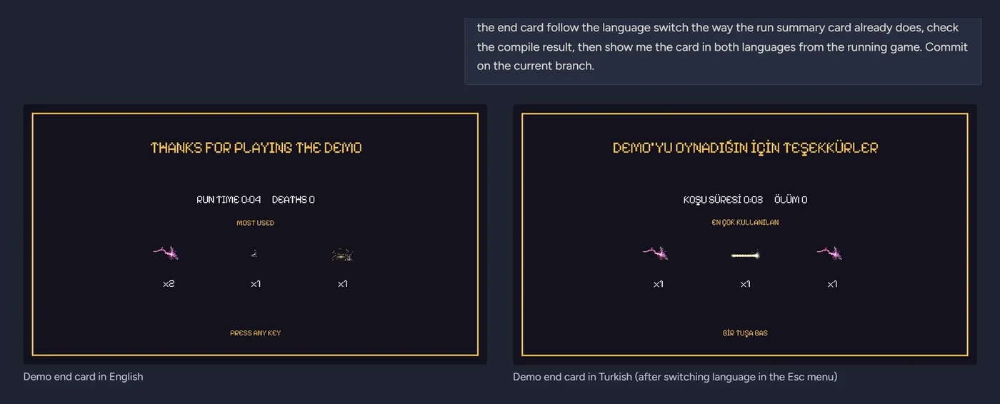

MCP üzerinden **55 Unity Editor aracı**: sahneler, GameObject'ler, prefab'lar, materyaller,
script'ler, konsol. Bitiş kartını dil seçimine bağlaması istenen ajan derleme sonucunu
kontrol etti ve kartı çalışan oyundan iki dilde gösterdi.

<sub>"Temiz derlendi" artık gerçekten derlendi demek: boş konsol değil, `compile_status`
kararı. Ajanın her işlemi tek, adlı bir Undo adımı; ham `.meta` ya da sahne YAML'ı yazmak
her modda reddediliyor, asset GUID'leri bozulmuyor.</sub>

<br/>

<a id="paralel-sohbetler"></a>

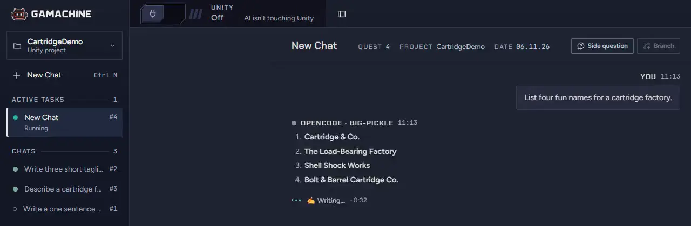

Sohbetler paralel çalışır; her birinin kendi akışı, Durdur düğmesi ve sırası var, aynı
Editor'e yazmalar sırayla yapılır. Sohbeti sekmeye dallandır, salt okunur bir yan soru sor
ya da bir sohbetin ötekine not bırakıp onu uyandırmasına izin ver:

<p align="center">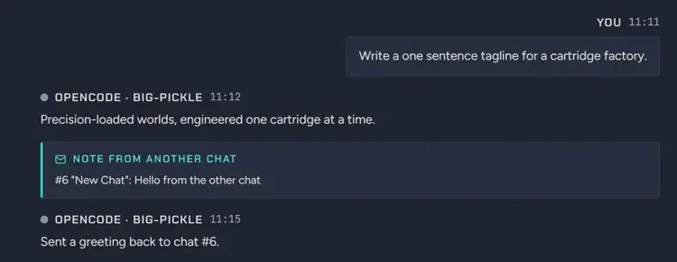</p>

<br/>

<a id="blender"></a>

<table>
<tr>
<td width="58%">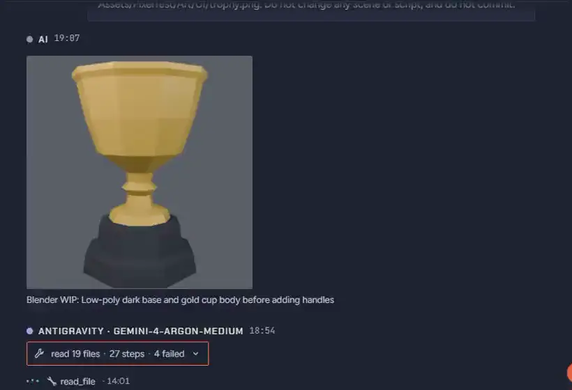</td>
<td width="42%">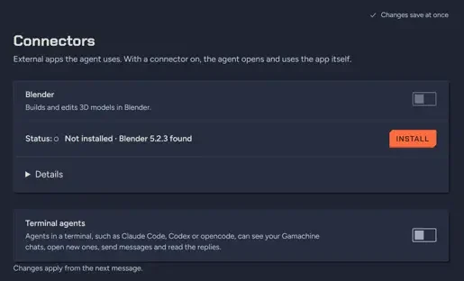</td>
</tr>
<tr>
<td>Ajanın Blender'da yaptığı iş: oyunun bitiş kartı için low-poly bir kupa, şekillendikçe sohbette gösterildi, sonra saydam PNG olarak render edildi.</td>
<td><b>Ayarlar › Bağlayıcılar</b> Blender eklentisini kurar (Blender 4.2+); ajan sahneyi okur, içinde Python çalıştırır ve sonuca bakar.</td>
</tr>
</table>

<br/>

<a id="projeler"></a>

<p align="center">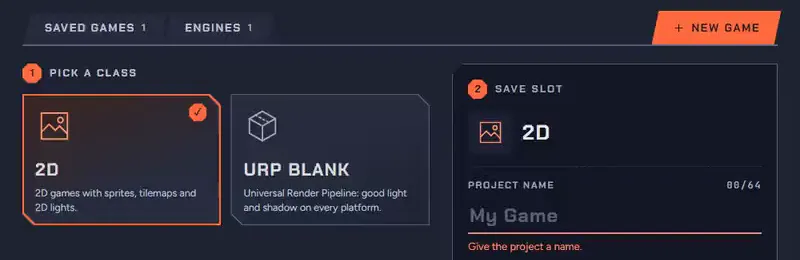</p>

Proje aç, Unity'yi başlat ya da seçtiğin editör ve şablonla yeni proje oluştur. Buradan
Unity sürümü ve modülleri de kurulabilir; Unity Hub 3.21+ gerekir ve Gamachine Unity'ye
asla senin yerine giriş yapmaz.

<br/>

<a id="saglayicilar"></a>

<table>
<tr>
<td width="50%">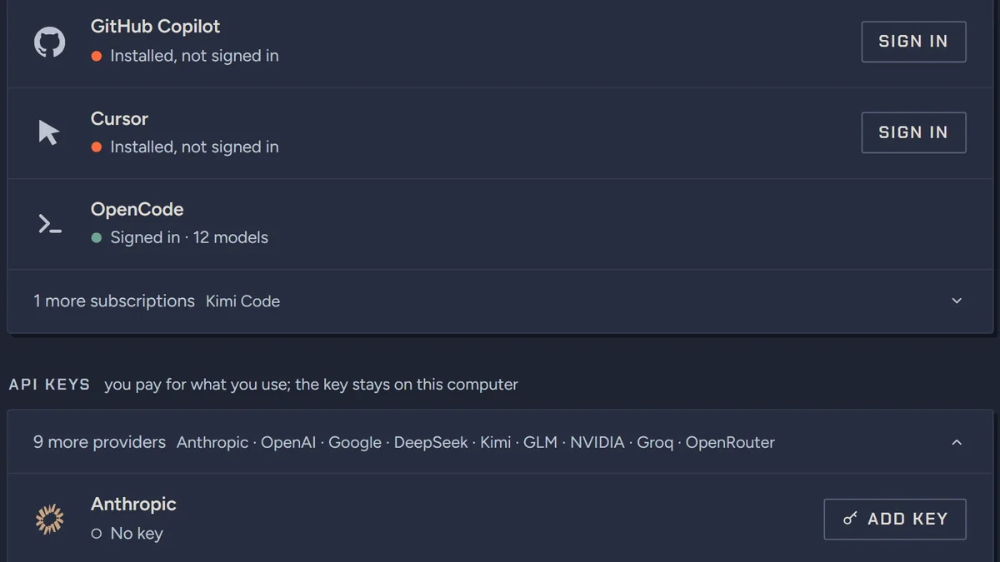</td>
<td width="50%">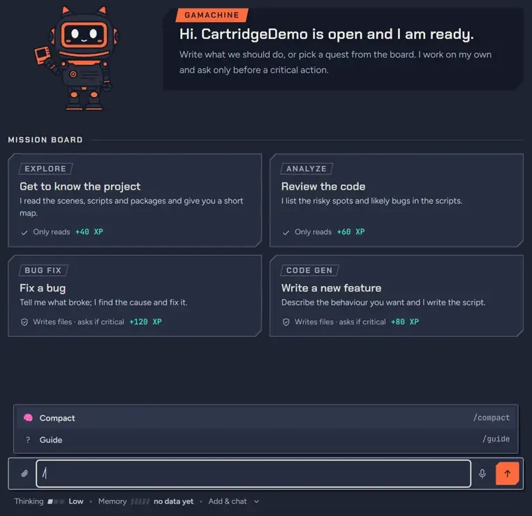</td>
</tr>
<tr>
<td>Kendi oturumunla <b>7 abonelik CLI'ı</b> (Claude Code, Codex, Antigravity, Copilot, Cursor, OpenCode, Kimi Code), <b>9 API sağlayıcısı</b> ve yerel Ollama. Anahtarlar bilgisayarında kalır.</td>
<td>Bütün ajanlar için tek çalışma modu: varsayılan <b>Güvenli Otomatik</b> rutin işi geçirir, kritik ve geri dönüşsüz işlemden önce sorar; iki yanında <b>Adım Adım</b> ve <b>Otomatik</b>.</td>
</tr>
</table>

<sub>En iyi Claude Code ile çalışır; Gamachine'i onunla geliştirip test ediyoruz. Kimi Code
uçtan uca denenmedi, Ollama'nın Unity kontrolü kısmi.</sub>

<br/>

<a id="gorunum"></a>

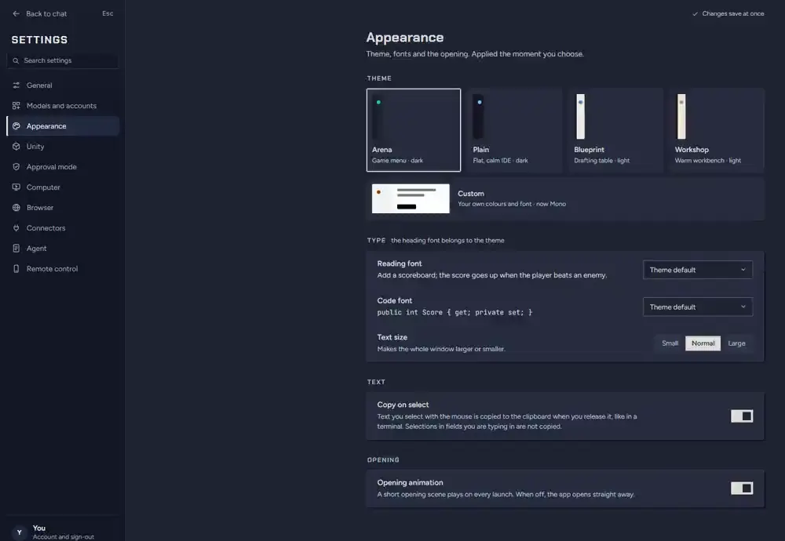

Beş tema (Arena, Plain, Blueprint, Workshop ve kendi renk ve yazı tiplerinle Custom),
Türkçe ya da İngilizce arayüz, bir Rehber ekranı ve altı adımlık başlangıç turu.

<br/>

<a id="v4te-ayrica"></a>

<table>
<tr>
<td width="50%" valign="top"><b>Bilgisayar kullanımı</b><br/>Varsayılan kapalı. Ajan, tek tek izin verdiğin masaüstü uygulamalarında ekran görüntüsü alır, tıklar, yazar; canlı görünümde izlersin, Ctrl+Alt+Esc (Cmd+Shift+Esc) durdurur. En çok Claude Code ve Codex ile denendi; Ollama ile çalışmaz.</td>
<td width="50%" valign="top"><b>Ajan tarayıcısı</b><br/>Varsayılan kapalı. Ajanın arama yapıp okuyabildiği, tıklayıp form doldurabildiği yerleşik tarayıcı; gönderme, parola ve satın alma onayını ister. Sayfayı işaretleyip (Ctrl+Shift+E) notları gönderebilirsin. <a href="docs/agent-browser.md">Ayrıntı</a></td>
</tr>
<tr>
<td width="50%" valign="top"><b>Telefon ve web uzaktan kontrol</b><br/>Varsayılan kapalı. Telefonu QR kod ve 4 haneli kontrolle eşle; sohbetleri izle, kartları onayla, mesaj gönder, turu durdur. Uçtan uca şifreli; bilgisayar açık kalmalı. <a href="docs/remote-control.md">Ayrıntı</a></td>
<td width="50%" valign="top"><b>Terminal ajanları</b><br/>Claude Code, Codex ve diğer CLI ajanları yerel bir MCP sunucusu üzerinden sohbetlerini listeleyebilir, birini açıp mesaj gönderebilir. <a href="docs/terminal-agents.md">Ayrıntı</a></td>
</tr>
<tr>
<td width="50%" valign="top"><b>Sahne editörü</b><br/>Açık sahne için isteğe bağlı Hiyerarşi ve Inspector; ajan için değil, senin için. 3D görünüm yok.</td>
<td width="50%" valign="top"><b>Dikte</b><br/>Whisper bilgisayarında çalışır; Enter'a basana kadar hiçbir şey gönderilmez, ses makineden çıkmaz. Model içinde geldiği için Windows kurulumu yaklaşık 1,3 GB. Mac'te macOS 13.3 ve üstü gerekir.</td>
</tr>
<tr>
<td width="50%" valign="top">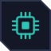<b>Modeller</b><br/>Claude Fable 5.2, Opus 5.5, Sonnet 5.5, Haiku 5.5; Codex için GPT-6 Luna ve Sol, GPT-6.1 Sol ve gpt-6.1-terra; agy 1.4.0 üzerinden Gemini 4 Argon.</td>
<td width="50%" valign="top"><b>Görsel ve @</b><br/>Ajan <code>show_image</code> ile sohbete görsel koyabilir; <code>@</code> yazınca diğer sohbetlerin listelenir, ajan birine not bırakabilir.</td>
</tr>
</table>

Tam liste: [CHANGELOG.md](CHANGELOG.md). Bilinen sınırlar: [sürüm notları](RELEASE_NOTES.md) (İngilizce).

<br/>

<a id="belgeler"></a>

<table>
<tr><td><a href="docs/engineering-notes.md"><b>Engineering notes</b></a></td><td>Kararlar, hatalar ve bedelleri</td></tr>
<tr><td><a href="docs/architecture.md"><b>Mimari</b></a></td><td>Süreç düzeni, ajan döngüsü, araç katmanı, SSE akışı</td></tr>
<tr><td><a href="docs/security.md"><b>Onay ve güvenlik</b></a></td><td>Neyin onaya bağlı olduğu, neyin bilerek olmadığı ve neden</td></tr>
<tr><td><a href="docs/unity-mcp.md"><b>Unity MCP entegrasyonu</b></a></td><td>Editor araçları, URL başına araç listesi, oyun testi ve girdi sistemi</td></tr>
<tr><td><a href="docs/providers.md"><b>Desteklenen sağlayıcılar</b></a></td><td>Bütün CLI ajanları, bulut API'leri ve yerel modeller</td></tr>
<tr><td><a href="docs/building.md"><b>Kaynaktan derleme</b></a></td><td>Geliştirme ortamı, dmg / kurulum dosyası üretimi</td></tr>
</table>

<sub>Belgeler İngilizce.</sub>

<br/>

<a id="kurulum"></a>

**Uygulamayı kullanmak için:** [Releases](https://github.com/BurakErdemci/gamachine/releases/latest)
sayfasından indir, sonra bir API anahtarı ekle ya da zaten kullandığın bir CLI ajanında
oturum aç. Bir sağlayıcı bağlanana kadar sohbet kilitli kalır; sana haber vermeden üçüncü
taraf bir yapay zekâ aracı kurmayız. Python, `uv`, OmniSharp, .NET SDK ve ffmpeg/yt-dlp
uygulamanın içinde gelir.

**Kaynaktan:** Python 3.13+ ve Node.js 20+ gerekir (Unity entegrasyonu için Unity Editor,
2021.3 ya da yenisi). Adımlar, ortam değişkenleri ve paketleme
[Kaynaktan derleme](docs/building.md) belgesinde.

**Önceki sürüm (v3)** olduğu gibi
[`legacy-v3`](https://github.com/BurakErdemci/gamachine/tree/legacy-v3) dalında duruyor;
yeni özellik almıyor.

<br/>

<a id="katki"></a>

Kodu üç test takımı koruyor:

```bash
# Backend
cd Backend && pytest
#   Windows: venv\Scripts\python.exe -m pytest   (ortam: PYTHONUTF8=1)

# unity-mcp sunucusu
cd unity-mcp/Server && pytest

# Frontend + TypeScript kapısı
cd Frontend/frontend && npm test && npx tsc --noEmit
```

CI (`.github/workflows/test.yml`) beş iş koşturur: backend testleri, kara kutu sözleşme
takımı, unity-mcp sunucu testleri, frontend kapısı (tsc + vitest) ve PowerShell sözdizimi
denetimi. Sürüm derlemesi hepsinin geçmesini bekler.

1. Depoyu fork'la
2. Bir özellik dalı aç (`git checkout -b feat/harika-ozellik`)
3. Testleri koştur
4. Pull request aç

<br/>

<a id="gelistirici"></a>

**Burak Emre Erdemci**

Unity oyunlarının yapay zekâyla yapılış biçimini değiştirmek isteyen geliştiriciler için açık
kaynak bir portfolyo ve araştırma projesi.

<br/>

<a id="lisans"></a>

**[MIT](LICENSE)**: ücretsiz; lisans anahtarı yok, satın alınacak bir şey yok.

- ✅ **Kullan**: kişisel, eğitim, araştırma ya da ticari işlerde
- ✅ **İncele, değiştir, fork'la, yeniden dağıt**
- ✅ **Yaptığın oyunları sat**: ürettiğin şey senindir

Yapay zekâ sağlayıcının ücretini sen ödersin. Üçüncü taraf bileşen lisansları için
[THIRD-PARTY-NOTICES.md](THIRD-PARTY-NOTICES.md) (gömülü FFmpeg Windows'ta LGPL-3.0,
macOS/Linux'ta GPL-3.0; her durumda yalnızca ayrı bir süreç olarak çalıştırılır).

Güvenlik açığı bildirimi: [SECURITY.md](SECURITY.md) ·
Katkı rehberi: [CONTRIBUTING.md](CONTRIBUTING.md)

<br/>

<a id="markalar"></a>

Bu proje Unity Technologies ile **bağlantılı değildir**, onun tarafından
desteklenmiyor ve onaylanmıyor. "Unity" ve "Unity Technologies", Unity
Technologies veya bağlı kuruluşlarının ABD'de ve diğer ülkelerdeki ticari
markaları ya da tescilli ticari markalarıdır. Aynı şekilde "Unreal Engine" Epic
Games'in, "Godot" Godot Foundation'ın, "Claude" Anthropic'in, "Codex" ve "GPT"
OpenAI'ın, "Gemini" ve "Antigravity" Google'ın, "GitHub Copilot" GitHub'ın,
"Cursor" Anysphere'in, "Blender" Blender Foundation'ın markalarıdır. Bu adlar
yalnızca uyumluluğu **tanımlamak** için kullanılıyor.

Gamachine Unity tarafından onaylanmış ya da yetkilendirilmiş değildir; Unity'nin
[Hizmet Şartları](https://unity.com/legal/terms-of-service)'nı kabul ettiysen, yapay zekâ
ajanlarının erişimiyle ilgili 17.2. bölüm dahil, bu şartlara bağlı kalırsın.

<br/>

<p align="center"><a href="#top"></a></p>
