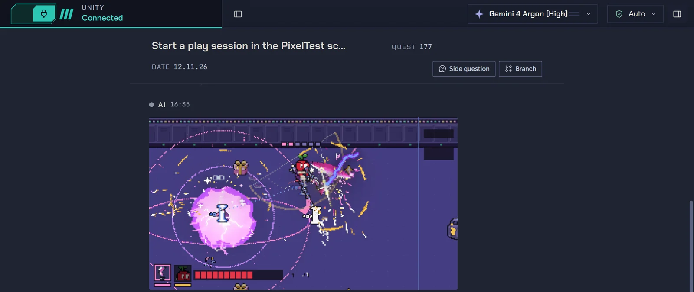
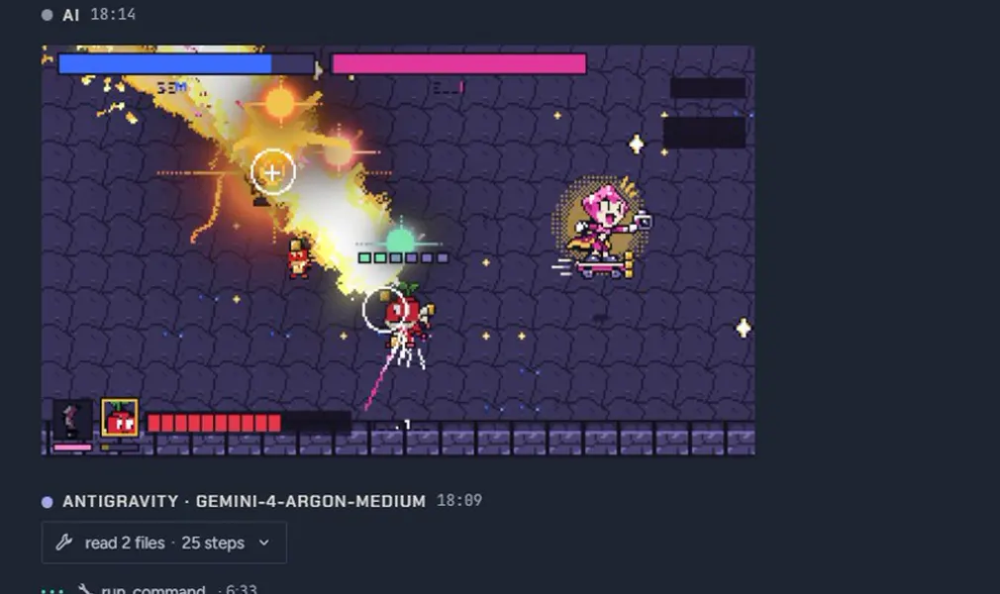
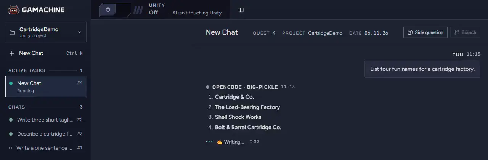
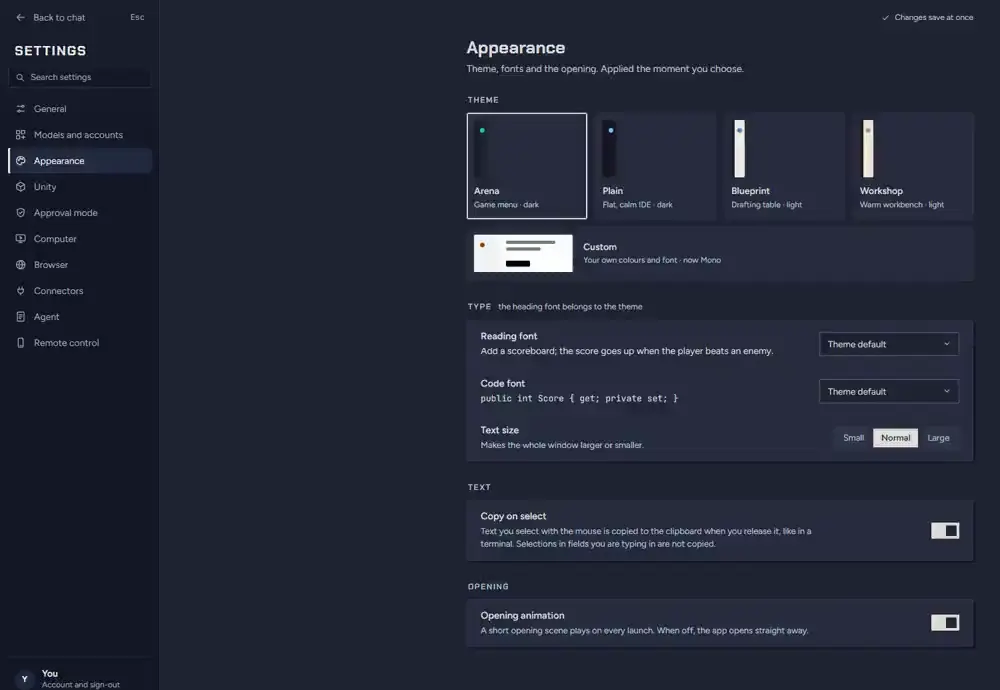
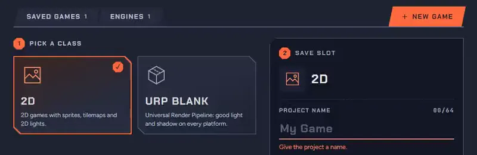
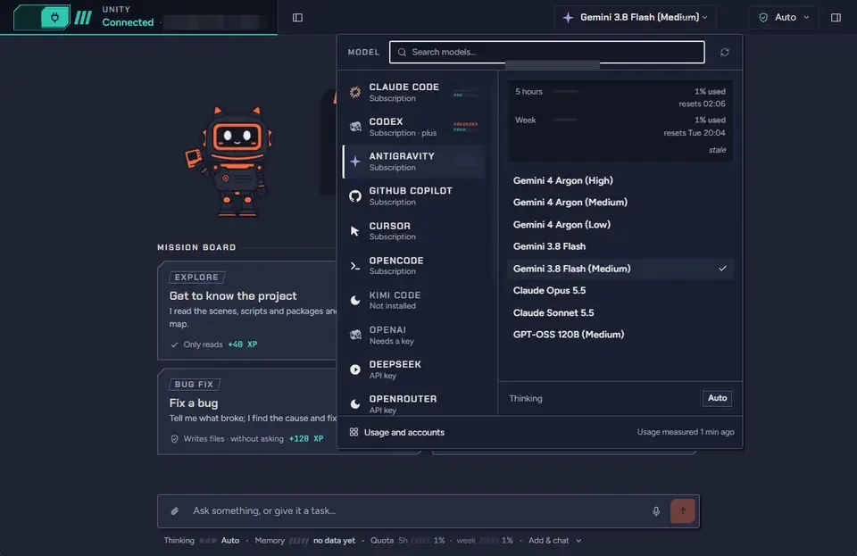
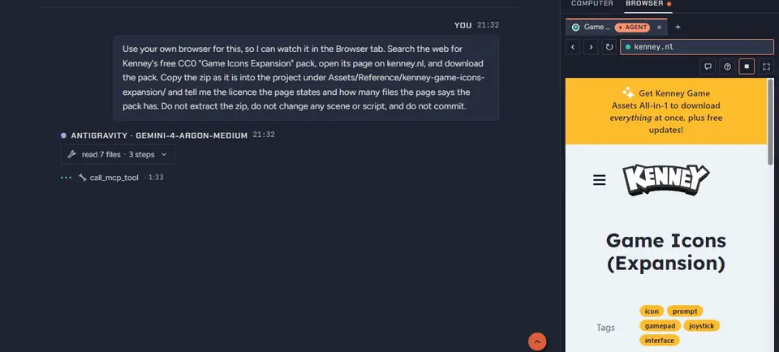
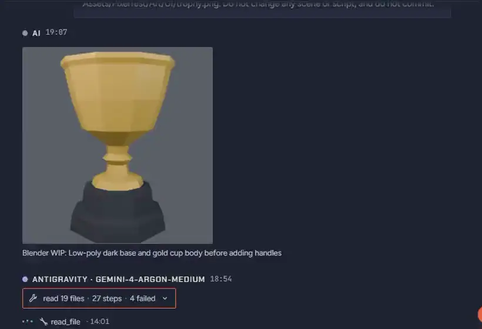

<!--
  ⚠️ THIS FILE IS MAINTAINED BY HAND and goes stale easily.
  `.github/workflows/release.yml` publishes it as the BODY of the draft release
  (`body_path: RELEASE_NOTES.md`). On 2 Aug 2026 it still held v2.2.0's text; had
  the release job run, v2.3.0 would have shipped the previous version's notes.
  ▶ BEFORE cutting a release: move the top section of `CHANGELOG.md` here.

  Written in English on purpose: the release page is where a stranger lands at the
  moment they download. (This comment is invisible on GitHub.)
  Images use absolute URLs pinned to the tag: a release body does not resolve
  repository-relative paths.
-->

## Gamachine v4.0.0

In v3 an agent wrote code and touched the Unity Editor while you checked the result
yourself. In v4 the agent can **play your game in the real Editor and look at what it
built**, several chats work on one project side by side, and agents can also use a
built-in browser, your desktop apps and Blender. The interface was rebuilt around
all of it.

> 🍎 **macOS (Apple Silicon):** `Gamachine-4.0.0-arm64.dmg`
> · 🪟 **Windows:** `Gamachine-Setup-4.0.0.exe`

**Windows:** the installer is not code-signed, so SmartScreen warns on first run.
Click **More info**, then **Run anyway**.
**macOS:** the app is signed with a Developer ID and notarized by Apple, so it opens
without a warning.

**Coming from v3?** v3.2.0's update notice only opens this page, so install 4.0.0 by
hand. From 4.0.0 on, updates download inside the app and install with one click,
and only after the release checks out against our own signed update manifest.

---

### The agent plays and tests your game

New Unity tools let an agent enter Play Mode in the real Editor, step the game frame
by frame while pressing keys and buttons, capture what the camera sees, run long
background playthroughs across many seeds, and read or call hooks your game declares.
It checks that the scripts compiled before it plays: a new compile verdict reports
clean, errors, compiling and so on, because an empty console is not a clean compile.

Every agent action in Unity is now one named undo step, and the agent can revert
exactly its own last action. Writing `.meta` files or Unity YAML assets as raw text
is refused in every mode, so agents cannot break asset GUIDs.

### Several chats at once

Chats run in parallel, each with its own stream, Stop and approval cards. Branch a
chat into a tab, ask a read-only question in a side chat, or let one chat leave a
note that wakes another. Messages typed during a turn are queued.

### A new interface

Everything was redrawn. Five themes: Arena (the dark default), Plain, Blueprint,
Workshop, and Custom with your own colours and fonts. A Guide screen and a six-step
starter tour show what the app can do. The app starts in English; Turkish is the
other choice.

The projects screen is now a small Unity Hub: launch Unity, create a project from a
template with the editor you pick, or install a Unity version and its modules
(Unity Hub 3.21+ is still required).

### Work modes

One global setting: **Auto**, **Step by Step**, or the new **Safe Auto**, the default
on a fresh install, which lets routine work through and asks only before critical,
irreversible actions. Approval cards were redrawn and say what the risk is.

### Computer use, browser and Blender

All three are off until you turn them on.

- **Computer use:** the agent takes screenshots, clicks and types in desktop apps,
  each of which you allow first. A live view and an indicator window show what it is
  doing; Ctrl+Alt+Esc (Cmd+Shift+Esc on macOS) stops it.
- **Agent browser:** a built-in browser the agent can search, read, click and fill
  forms in. Submitting, passwords and purchases need your approval. Annotate a page
  with numbered notes (Ctrl+Shift+E) and send them to the agent.
- **Blender:** Settings > Connectors installs the Blender add-on (Blender 4.2+). The
  agent can then read the scene, run Python in it and look at the result.

### Also new

- **Phone and web remote:** pair a phone with a QR code and a 4-digit check, then
  watch chats, approve cards, send messages and stop turns from it. End-to-end
  encrypted; the PC must stay on.
- **Dictation** now runs Whisper on your computer: on the owner's recordings it made
  about half as many mistakes as the best alternative tested, and no audio leaves
  the machine. The Windows installer is about 1.3 GB because the model ships inside
  it. On a Mac it needs macOS 13.3 or newer, and the very first dictation after
  installing waits about 20 seconds.
- **Models:** Claude Fable 5.2, Opus 5.5, Sonnet 5.5 and Haiku 5.5; GPT-6 Luna and
  Sol, GPT-6.1 Sol and gpt-6.1-terra for Codex; Gemini 4 Argon through agy 1.4.0.
- **Terminal agents** such as Claude Code or Codex can open and message Gamachine
  chats through a local MCP server.
- A Hierarchy and Inspector **scene editor** for you (not the agent), and `show_image`
  so agents can put an image in the chat.

### Fixes

Switching projects moves Unity to the new project, and Gamachine refuses to drive an
Editor that has a different project open. Unity stops retrying a lost connection
after 5 minutes instead of forever. A crashed Unity MCP server restarts by itself,
less and less often if something keeps killing it. A project whose Unity version is
missing offers to install it. Cancelled or timed-out jobs no longer leave background
processes behind. Antigravity turns that hit a time limit or quota say so and list the
files they changed, and an Antigravity chat left idle for 15 minutes frees its
memory and continues the same conversation on the next message (a command it left
running keeps the chat open).

### Known limits

- macOS builds are Apple Silicon only; there is no Linux build.
- Playtesting needs Unity's Input System package; games that read the old
  `Input.GetKey` must be driven through hooks. A bot playing proves the game runs,
  not that it is fun. Playtests have been measured on Windows only so far.
- Computer use is tested most with Claude Code and Codex, and does not work with
  Ollama. Blender is tested on Windows only.
- Installing a Unity version from Gamachine is new and has seen little real use.
- Kimi Code has not been exercised end to end.

Full list: [CHANGELOG.md](https://github.com/BurakErdemci/gamachine/blob/v4.0.0/CHANGELOG.md).
